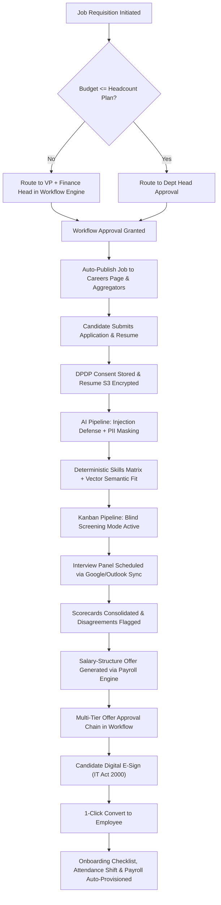
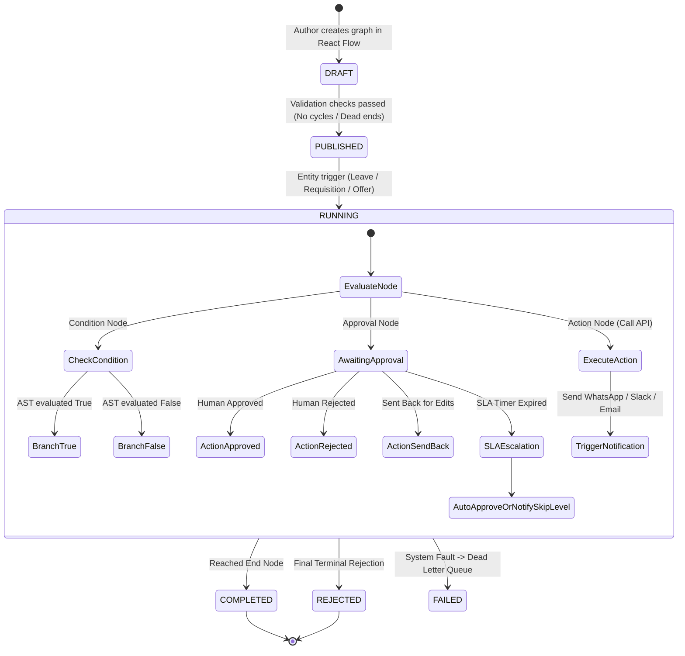
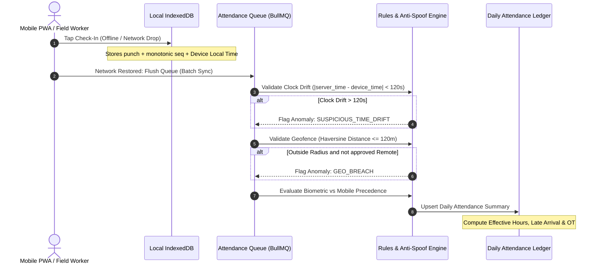
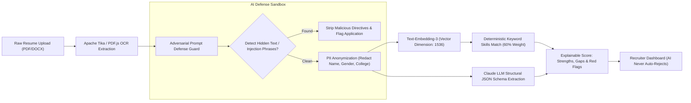

# NovaHR // Enterprise Architecture & Module Design Specification
**Version:** 1.0.0-PROD  
**Target:** Indian SMEs & Mid-market Enterprises (DPDP Act 2023 Compliant)  
**Stack:** Next.js 16 + React 19 + TypeScript + Tailwind CSS / shadcn/ui, NestJS, PostgreSQL 16 (Row-Level Security Multi-Tenancy via `tenant_id`, pgvector), Redis, BullMQ, S3-Compatible Storage, Anthropic Claude (Provider-Agnostic Adapter).

---

## 1. Architectural Assumptions & System Tenets

1. **Row-Level Security (RLS) Multi-Tenancy:**
   - Every database table enforces a non-nullable `tenant_id UUID`.
   - PostgreSQL RLS policies (`CREATE POLICY tenant_isolation_policy ON <table> USING (tenant_id = current_setting('app.current_tenant_id')::uuid)`) guarantee zero cross-tenant data leakage at the query engine level.
2. **Indian Regulatory & Statutory Alignment:**
   - **DPDP Act 2023 (Digital Personal Data Protection):** Explicit data processing consent checkpoints, PII redaction during algorithmic scoring, purpose limitation, and candidate "Right to be Forgotten" erasure workflows.
   - **Payroll & Tax Code:** Real-time alignment with Indian statutory payroll mechanics (EPF 12% ceiling/actuals, ESI ₹21,000 threshold, State Professional Tax slabs, New Tax Regime Section 115BAC).
3. **No-Code Deterministic Workflows First, AI as Co-Pilot:**
   - Approvals, state transitions, shift logic, and compliance evaluations are **strictly deterministic state machines** governed by a sandboxed, zero-eval Abstract Syntax Tree (AST) expression evaluator.
   - LLM intelligence is reserved for synthesis, semantic matching, contextual drafting, and anomaly summarization. **AI never makes final unilateral rejections or disciplinary decisions.**
4. **Offline-First Mobile Ingest Resiliency:**
   - The Mobile Attendance PWA functions completely offline via IndexedDB transaction queues, cryptographically secured with monotonic local sequence numbers and HMAC nonces verified upon server reconnect.

---

## 2. PostgreSQL Relational & Vector Data Models

### 2.1. Module 1: AI-Powered Hiring / ATS

```sql
-- Extensions
CREATE EXTENSION IF NOT EXISTS "uuid-ossp";
CREATE EXTENSION IF NOT EXISTS "vector";
CREATE EXTENSION IF NOT EXISTS "pg_trgm";

-- 1. Job Requisition (Headcount Budget & Approval)
CREATE TABLE job_requisitions (
    id UUID PRIMARY KEY DEFAULT uuid_generate_v4(),
    tenant_id UUID NOT NULL,
    requisition_code VARCHAR(32) NOT NULL, -- e.g., 'REQ-ENG-2026-042'
    title VARCHAR(255) NOT NULL,
    department VARCHAR(100) NOT NULL,
    employment_type VARCHAR(50) NOT NULL DEFAULT 'Full-Time', -- 'Full-Time', 'Contract', 'Intern'
    headcount_requested INT NOT NULL DEFAULT 1,
    budget_min_inr NUMERIC(12, 2) NOT NULL,
    budget_max_inr NUMERIC(12, 2) NOT NULL,
    target_hire_date DATE NOT NULL,
    hiring_manager_id UUID NOT NULL,
    justification TEXT NOT NULL,
    workflow_instance_id UUID,
    status VARCHAR(50) NOT NULL DEFAULT 'DRAFT', -- 'DRAFT', 'PENDING_APPROVAL', 'APPROVED', 'REJECTED', 'CLOSED'
    created_at TIMESTAMPTZ NOT NULL DEFAULT NOW(),
    updated_at TIMESTAMPTZ NOT NULL DEFAULT NOW(),
    CONSTRAINT uk_tenant_req_code UNIQUE (tenant_id, requisition_code)
);
CREATE INDEX idx_job_req_tenant_status ON job_requisitions(tenant_id, status);

-- 2. Branded Job Postings (Public Careers & Aggregators)
CREATE TABLE job_postings (
    id UUID PRIMARY KEY DEFAULT uuid_generate_v4(),
    tenant_id UUID NOT NULL,
    requisition_id UUID NOT NULL REFERENCES job_requisitions(id) ON DELETE RESTRICT,
    slug VARCHAR(255) NOT NULL,
    title VARCHAR(255) NOT NULL,
    location VARCHAR(150) NOT NULL DEFAULT 'Mohali, Punjab (Hybrid)',
    experience_min_years NUMERIC(3, 1) NOT NULL DEFAULT 2.0,
    experience_max_years NUMERIC(3, 1) NOT NULL DEFAULT 6.0,
    must_have_skills TEXT[] NOT NULL DEFAULT '{}',
    good_to_have_skills TEXT[] NOT NULL DEFAULT '{}',
    description_markdown TEXT NOT NULL,
    custom_screening_questions JSONB NOT NULL DEFAULT '[]', -- [{id, question, type, required}]
    multi_post_channels JSONB NOT NULL DEFAULT '{"naukri": false, "linkedin": false, "indeed": false}',
    is_public BOOLEAN NOT NULL DEFAULT true,
    status VARCHAR(50) NOT NULL DEFAULT 'ACTIVE', -- 'ACTIVE', 'PAUSED', 'FILLED', 'ARCHIVED'
    created_at TIMESTAMPTZ NOT NULL DEFAULT NOW(),
    updated_at TIMESTAMPTZ NOT NULL DEFAULT NOW(),
    CONSTRAINT uk_tenant_job_slug UNIQUE (tenant_id, slug)
);
CREATE INDEX idx_job_postings_tenant_slug ON job_postings(tenant_id, slug);

-- 3. Candidates (Global per tenant, deduplicated)
CREATE TABLE candidates (
    id UUID PRIMARY KEY DEFAULT uuid_generate_v4(),
    tenant_id UUID NOT NULL,
    full_name VARCHAR(255) NOT NULL,
    email VARCHAR(255) NOT NULL,
    phone VARCHAR(32) NOT NULL,
    current_company VARCHAR(255),
    current_designation VARCHAR(255),
    total_experience_years NUMERIC(4, 1),
    notice_period_days INT DEFAULT 30,
    current_ctc_inr NUMERIC(12, 2),
    expected_ctc_inr NUMERIC(12, 2),
    location VARCHAR(150),
    source VARCHAR(100) NOT NULL DEFAULT 'Careers Page', -- 'LinkedIn', 'Naukri', 'Referral', 'Agency'
    referred_by_employee_id UUID,
    referral_bonus_inr NUMERIC(10, 2) DEFAULT 0,
    dpdp_consent_given BOOLEAN NOT NULL DEFAULT false,
    dpdp_consent_timestamp TIMESTAMPTZ,
    data_retention_expiry TIMESTAMPTZ,
    created_at TIMESTAMPTZ NOT NULL DEFAULT NOW(),
    updated_at TIMESTAMPTZ NOT NULL DEFAULT NOW(),
    CONSTRAINT uk_tenant_candidate_email UNIQUE (tenant_id, email)
);
CREATE INDEX idx_candidates_fuzzy_name ON candidates USING gin (full_name gin_trgm_ops);
CREATE INDEX idx_candidates_phone ON candidates(tenant_id, phone);

-- 4. Candidate Applications & AI Embeddings
CREATE TABLE candidate_applications (
    id UUID PRIMARY KEY DEFAULT uuid_generate_v4(),
    tenant_id UUID NOT NULL,
    job_posting_id UUID NOT NULL REFERENCES job_postings(id) ON DELETE CASCADE,
    candidate_id UUID NOT NULL REFERENCES candidates(id) ON DELETE CASCADE,
    stage VARCHAR(50) NOT NULL DEFAULT 'APPLIED', -- 'APPLIED', 'AI_SCREENED', 'SHORTLISTED', 'TECHNICAL_ROUND_1', 'TECHNICAL_ROUND_2', 'CULTURE_FIT', 'OFFER_EXTENDED', 'HIRED', 'REJECTED'
    stage_updated_at TIMESTAMPTZ NOT NULL DEFAULT NOW(),
    resume_storage_key VARCHAR(512) NOT NULL,
    parsed_structured_json JSONB,
    resume_embedding vector(1536), -- pgvector embeddings for semantic JD matching
    
    -- AI Evaluation & Guardrails
    ai_overall_score NUMERIC(5, 2), -- 0.00 to 100.00
    ai_skills_match_score NUMERIC(5, 2),
    ai_experience_fit_score NUMERIC(5, 2),
    ai_reasoning_breakdown JSONB, -- {must_haves_matched: [], gaps: [], red_flags: [], strengths: []}
    ai_adversarial_flags JSONB DEFAULT '[]', -- [{type: 'HIDDEN_TEXT_DETECTED', text: '...', confidence: 0.98}]
    recruiter_override_score NUMERIC(5, 2),
    recruiter_override_notes TEXT,
    is_blind_screened BOOLEAN NOT NULL DEFAULT true, -- Bias-reduction mode
    
    created_at TIMESTAMPTZ NOT NULL DEFAULT NOW(),
    updated_at TIMESTAMPTZ NOT NULL DEFAULT NOW(),
    CONSTRAINT uk_tenant_job_candidate UNIQUE (tenant_id, job_posting_id, candidate_id)
);
CREATE INDEX idx_applications_stage ON candidate_applications(tenant_id, job_posting_id, stage);
CREATE INDEX idx_applications_ai_score ON candidate_applications(tenant_id, ai_overall_score DESC);

-- 5. Interview Scorecards & Calibration
CREATE TABLE interview_scorecards (
    id UUID PRIMARY KEY DEFAULT uuid_generate_v4(),
    tenant_id UUID NOT NULL,
    application_id UUID NOT NULL REFERENCES candidate_applications(id) ON DELETE CASCADE,
    interviewer_id UUID NOT NULL,
    round_name VARCHAR(100) NOT NULL, -- 'Technical Round 1: React & System Architecture'
    competency_ratings JSONB NOT NULL, -- {coding: 4, problem_solving: 5, communication: 4}
    pros TEXT NOT NULL,
    cons TEXT NOT NULL,
    ai_meeting_notes_summary TEXT,
    recommendation VARCHAR(50) NOT NULL, -- 'STRONG_HIRE', 'HIRE', 'NEUTRAL', 'NO_HIRE'
    submitted_at TIMESTAMPTZ NOT NULL DEFAULT NOW()
);

-- 6. Offers & Payroll CTC Alignment
CREATE TABLE job_offers (
    id UUID PRIMARY KEY DEFAULT uuid_generate_v4(),
    tenant_id UUID NOT NULL,
    application_id UUID NOT NULL REFERENCES candidate_applications(id) ON DELETE RESTRICT,
    annual_ctc_inr NUMERIC(12, 2) NOT NULL,
    basic_salary_inr NUMERIC(12, 2) NOT NULL,
    hra_inr NUMERIC(12, 2) NOT NULL,
    special_allowance_inr NUMERIC(12, 2) NOT NULL,
    annual_performance_bonus_inr NUMERIC(12, 2) NOT NULL DEFAULT 0,
    epf_employer_inr NUMERIC(12, 2) NOT NULL,
    gratuity_inr NUMERIC(12, 2) NOT NULL,
    joining_date DATE NOT NULL,
    offer_expiry_date DATE NOT NULL,
    workflow_instance_id UUID,
    status VARCHAR(50) NOT NULL DEFAULT 'DRAFT', -- 'DRAFT', 'APPROVAL_PENDING', 'APPROVED', 'SENT', 'ACCEPTED', 'DECLINED', 'EXPIRED'
    e_signature_hash VARCHAR(256),
    signed_at TIMESTAMPTZ,
    created_at TIMESTAMPTZ NOT NULL DEFAULT NOW(),
    updated_at TIMESTAMPTZ NOT NULL DEFAULT NOW()
);
```

---

### 2.2. Module 2: Generic No-Code Workflow Builder

```sql
-- 7. Workflow Definitions (Graph schema in JSONB)
CREATE TABLE workflow_definitions (
    id UUID PRIMARY KEY DEFAULT uuid_generate_v4(),
    tenant_id UUID NOT NULL,
    code VARCHAR(64) NOT NULL, -- 'LEAVE_APPROVAL', 'JOB_REQUISITION', 'EXPENSE_REIMBURSEMENT', 'ATTENDANCE_REGULARIZATION', 'OFFER_APPROVAL'
    name VARCHAR(255) NOT NULL,
    description TEXT,
    version INT NOT NULL DEFAULT 1,
    is_active BOOLEAN NOT NULL DEFAULT true,
    nodes JSONB NOT NULL, -- [{id, type: 'trigger'|'condition'|'approval'|'action'|'notification'|'wait'|'end', data: {...}, position: {x, y}}]
    edges JSONB NOT NULL, -- [{id, source, target, sourceHandle, label, conditionExpression}]
    validation_status VARCHAR(50) NOT NULL DEFAULT 'VALID', -- 'VALID', 'HAS_ERRORS'
    created_by UUID NOT NULL,
    created_at TIMESTAMPTZ NOT NULL DEFAULT NOW(),
    updated_at TIMESTAMPTZ NOT NULL DEFAULT NOW(),
    CONSTRAINT uk_tenant_wf_code_ver UNIQUE (tenant_id, code, version)
);
CREATE INDEX idx_wf_def_tenant_code ON workflow_definitions(tenant_id, code, is_active);

-- 8. Workflow Instances (Execution State Machine)
CREATE TABLE workflow_instances (
    id UUID PRIMARY KEY DEFAULT uuid_generate_v4(),
    tenant_id UUID NOT NULL,
    workflow_definition_id UUID NOT NULL REFERENCES workflow_definitions(id) ON DELETE RESTRICT,
    workflow_version INT NOT NULL,
    initiator_id UUID NOT NULL,
    entity_type VARCHAR(64) NOT NULL, -- 'LEAVE_REQUEST', 'JOB_OFFER', 'REQUISITION', 'ATTENDANCE_REG'
    entity_id UUID NOT NULL,
    current_node_id VARCHAR(64) NOT NULL,
    status VARCHAR(50) NOT NULL DEFAULT 'RUNNING', -- 'RUNNING', 'WAITING_APPROVAL', 'ESCALATED', 'COMPLETED', 'REJECTED', 'TIMED_OUT', 'CANCELLED'
    context_data JSONB NOT NULL DEFAULT '{}', -- Payload evaluated by condition expressions
    started_at TIMESTAMPTZ NOT NULL DEFAULT NOW(),
    completed_at TIMESTAMPTZ,
    updated_at TIMESTAMPTZ NOT NULL DEFAULT NOW()
);
CREATE INDEX idx_wf_inst_tenant_status ON workflow_instances(tenant_id, status);
CREATE INDEX idx_wf_inst_entity ON workflow_instances(tenant_id, entity_type, entity_id);

-- 9. Workflow Step Executions (Audit & Action Ledger)
CREATE TABLE workflow_step_executions (
    id UUID PRIMARY KEY DEFAULT uuid_generate_v4(),
    tenant_id UUID NOT NULL,
    instance_id UUID NOT NULL REFERENCES workflow_instances(id) ON DELETE CASCADE,
    node_id VARCHAR(64) NOT NULL,
    node_type VARCHAR(32) NOT NULL,
    assigned_to_user_id UUID,
    assigned_role VARCHAR(64),
    status VARCHAR(50) NOT NULL DEFAULT 'PENDING', -- 'PENDING', 'APPROVED', 'REJECTED', 'SKIPPED', 'DELEGATED', 'AUTO_TIMEOUT'
    action_taken_by UUID,
    action_note TEXT,
    sla_due_at TIMESTAMPTZ,
    out_of_app_token_hash VARCHAR(256), -- Expiring HMAC single-use link for Email/WhatsApp/Slack
    token_expires_at TIMESTAMPTZ,
    executed_at TIMESTAMPTZ,
    created_at TIMESTAMPTZ NOT NULL DEFAULT NOW()
);
CREATE INDEX idx_wf_steps_pending ON workflow_step_executions(tenant_id, assigned_to_user_id, status);
```

---

### 2.3. Module 3: Mobile-First Attendance & Ingestion Engine

```sql
-- 10. Office Geofences & Wi-Fi Anchors
CREATE TABLE office_sites (
    id UUID PRIMARY KEY DEFAULT uuid_generate_v4(),
    tenant_id UUID NOT NULL,
    name VARCHAR(150) NOT NULL, -- 'Mohali HQ Campus - Tower B'
    latitude NUMERIC(10, 8) NOT NULL,
    longitude NUMERIC(11, 8) NOT NULL,
    radius_meters INT NOT NULL DEFAULT 120,
    allowed_bssid_list TEXT[] DEFAULT '{}',
    allowed_ip_cidrs TEXT[] DEFAULT '{}',
    is_active BOOLEAN NOT NULL DEFAULT true
);

-- 11. Shift Policies & Grace Calculations
CREATE TABLE shift_policies (
    id UUID PRIMARY KEY DEFAULT uuid_generate_v4(),
    tenant_id UUID NOT NULL,
    name VARCHAR(100) NOT NULL, -- 'General Corporate Shift'
    start_time TIME NOT NULL DEFAULT '09:00:00',
    end_time TIME NOT NULL DEFAULT '18:30:00',
    grace_period_minutes INT NOT NULL DEFAULT 15,
    half_day_threshold_minutes INT NOT NULL DEFAULT 240, -- 4 hours
    full_day_threshold_minutes INT NOT NULL DEFAULT 480, -- 8 hours
    crosses_midnight BOOLEAN NOT NULL DEFAULT false,
    overtime_enabled BOOLEAN NOT NULL DEFAULT true,
    created_at TIMESTAMPTZ NOT NULL DEFAULT NOW()
);

-- 12. Raw Ingested Punches (High-Throughput Partitioned Ledger)
CREATE TABLE attendance_punches (
    id UUID PRIMARY KEY DEFAULT uuid_generate_v4(),
    tenant_id UUID NOT NULL,
    employee_id UUID NOT NULL,
    punch_type VARCHAR(16) NOT NULL, -- 'CHECK_IN', 'CHECK_OUT', 'BREAK_IN', 'BREAK_OUT'
    punch_timestamp TIMESTAMPTZ NOT NULL, -- UTC
    device_local_timestamp VARCHAR(64) NOT NULL,
    source_channel VARCHAR(32) NOT NULL, -- 'MOBILE_PWA', 'BIOMETRIC_API', 'OFFLINE_SYNC', 'QR_SCAN'
    latitude NUMERIC(10, 8),
    longitude NUMERIC(11, 8),
    accuracy_meters NUMERIC(6, 2),
    is_mock_location BOOLEAN NOT NULL DEFAULT false,
    selfie_image_url VARCHAR(512),
    selfie_liveness_score NUMERIC(4, 3),
    device_fingerprint VARCHAR(128) NOT NULL,
    offline_sync_id VARCHAR(64),
    server_time_drift_seconds INT NOT NULL DEFAULT 0,
    anomaly_flag VARCHAR(64) DEFAULT 'NONE', -- 'NONE', 'IMPOSSIBLE_TRAVEL', 'GEO_BREACH', 'MOCK_DETECTED'
    created_at TIMESTAMPTZ NOT NULL DEFAULT NOW()
);
CREATE INDEX idx_punches_employee_time ON attendance_punches(tenant_id, employee_id, punch_timestamp);

-- 13. Daily Attendance Summaries & Payroll Lock
CREATE TABLE daily_attendance_summaries (
    id UUID PRIMARY KEY DEFAULT uuid_generate_v4(),
    tenant_id UUID NOT NULL,
    employee_id UUID NOT NULL,
    attendance_date DATE NOT NULL,
    shift_id UUID REFERENCES shift_policies(id),
    first_punch_in TIMESTAMPTZ,
    last_punch_out TIMESTAMPTZ,
    total_effective_minutes INT NOT NULL DEFAULT 0,
    total_break_minutes INT NOT NULL DEFAULT 0,
    overtime_minutes INT NOT NULL DEFAULT 0,
    status VARCHAR(32) NOT NULL DEFAULT 'PRESENT', -- 'PRESENT', 'WFH', 'LATE', 'HALF_DAY', 'ON_LEAVE', 'ABSENT', 'WEEKEND', 'HOLIDAY'
    is_regularized BOOLEAN NOT NULL DEFAULT false,
    regularization_request_id UUID,
    is_locked_for_payroll BOOLEAN NOT NULL DEFAULT false,
    payroll_batch_id UUID,
    created_at TIMESTAMPTZ NOT NULL DEFAULT NOW(),
    updated_at TIMESTAMPTZ NOT NULL DEFAULT NOW(),
    CONSTRAINT uk_tenant_emp_date UNIQUE (tenant_id, employee_id, attendance_date)
);
CREATE INDEX idx_daily_summary_payroll ON daily_attendance_summaries(tenant_id, attendance_date, is_locked_for_payroll);
```

---

## 3. OpenAPI 3.1 REST API Specification (Endpoints)

```yaml
openapi: 3.1.0
info:
  title: NovaHR Core API
  version: 1.0.0
  description: Unified HRMS Engine covering AI ATS, Generic Workflows, and Mobile Attendance.
paths:

  # -------------------------------------------------------------
  # MODULE 1: AI ATS
  # -------------------------------------------------------------
  /api/v1/ats/requisitions:
    post:
      summary: Create headcount requisition and trigger approval workflow
      requestBody:
        content:
          application/json:
            schema:
              type: object
              required: [title, department, headcount_requested, budget_min_inr, budget_max_inr, target_hire_date, justification]
      responses:
        201: { description: Requisition created & routed to workflow }

  /api/v1/ats/jobs/{slug}/apply:
    post:
      summary: Public Candidate Application Endpoint (Multipart Form + Resume OCR/Parse)
      requestBody:
        content:
          multipart/form-data:
            schema:
              type: object
              required: [full_name, email, phone, resume_file, dpdp_consent]
      responses:
        201: { description: Application received, queued for AI sanitization and parsing }

  /api/v1/ats/applications/{id}/score:
    post:
      summary: Trigger Explainable AI Scoring with Prompt-Injection Defense
      responses:
        200:
          content:
            application/json:
              schema:
                type: object
                properties:
                  overall_score: { type: number }
                  skills_match: { type: number }
                  experience_fit: { type: number }
                  must_haves_matched: { type: array, items: { type: string } }
                  gaps: { type: array, items: { type: string } }
                  adversarial_flags: { type: array }

  /api/v1/ats/applications/{id}/convert-to-employee:
    post:
      summary: 1-Click convert accepted candidate to provisioned employee record
      responses:
        200: { description: Employee record and onboarding checklist initialized }

  # -------------------------------------------------------------
  # MODULE 2: WORKFLOW BUILDER
  # -------------------------------------------------------------
  /api/v1/workflows/definitions:
    get:
      summary: List all published & draft workflow graphs
    post:
      summary: Create or version a visual workflow graph
      requestBody:
        content:
          application/json:
            schema:
              type: object
              required: [code, name, nodes, edges]
      responses:
        201: { description: Workflow graph saved and validated }

  /api/v1/workflows/instances/{id}/action:
    post:
      summary: Execute human or system action (Approve, Reject, Send-back, Delegate)
      requestBody:
        content:
          application/json:
            schema:
              type: object
              required: [step_id, action]
              properties:
                step_id: { type: string }
                action: { type: string, enum: [APPROVE, REJECT, SEND_BACK, DELEGATE] }
                note: { type: string }
      responses:
        200: { description: State machine transitioned to next node }

  /api/v1/workflows/out-of-app-approve:
    get:
      summary: Single-use signed token approval for Email/Slack/WhatsApp
      parameters:
        - name: token
          in: query
          required: true
          schema: { type: string }
        - name: action
          in: query
          required: true
          schema: { type: string }

  # -------------------------------------------------------------
  # MODULE 3: MOBILE-FIRST ATTENDANCE
  # -------------------------------------------------------------
  /api/v1/attendance/punch:
    post:
      summary: Ingest single live check-in / check-out with Geo-fence & Selfie check
      requestBody:
        content:
          application/json:
            schema:
              type: object
              required: [punch_type, latitude, longitude, device_fingerprint, local_timestamp]
      responses:
        201: { description: Punch verified and recorded }

  /api/v1/attendance/offline-sync:
    post:
      summary: Ingest queued offline punches with server-drift and tamper verification
      requestBody:
        content:
          application/json:
            schema:
              type: object
              required: [punches]
              properties:
                punches:
                  type: array
                  items:
                    type: object
                    required: [offline_id, punch_type, local_timestamp, monotonic_sequence]
      responses:
        200: { description: Batch ingested; anomalies highlighted }

  /api/v1/attendance/cycle-lock:
    post:
      summary: Lock monthly attendance cycle and hand off Loss of Pay (LOP) & Overtime to Payroll
      requestBody:
        content:
          application/json:
            schema:
              type: object
              required: [month, year]
      responses:
        200: { description: Attendance finalized and locked }
```

---

## 4. Workflow Engine State Machine & AST Expression Grammar

### 4.1. Safe AST Expression Grammar (Zero `eval()`)
To ensure complete isolation against code-injection vulnerabilities, condition nodes evaluate requests using a recursive descent token parser supporting:
- Operators: `==`, `!=`, `>`, `<`, `>=`, `<=`, `IN`, `NOT IN`, `AND`, `OR`, `NOT`.
- Context Variable Access: `request.amount`, `request.days`, `candidate.expected_ctc`, `employee.department`.
- Example AST rule:
  ```json
  {
    "type": "LogicalExpression",
    "operator": "AND",
    "left": {
      "type": "BinaryExpression",
      "operator": ">",
      "left": { "type": "Identifier", "name": "request.days" },
      "right": { "type": "Literal", "value": 3 }
    },
    "right": {
      "type": "BinaryExpression",
      "operator": "==",
      "left": { "type": "Identifier", "name": "request.leave_type" },
      "right": { "type": "Literal", "value": "SICK" }
    }
  }
  ```

---

## 5. Visual Mermaid Diagrams of Key Flows

### 5.1. End-to-End Hiring, Workflow & Onboarding Flow



---

### 5.2. Workflow Engine State Machine & Timeout Escalation



---

### 5.3. Mobile Attendance Offline Sync & Anti-Spoofing Architecture



---

### 5.4. Prompt-Injection Resilient AI Resume Parsing Pipeline



---

## 6. Offline Attendance & Edge Verification Design

### 6.1. Trusted Timestamp & Sequence Numbering
1. Mobile devices generate an auto-incrementing integer sequence counter stored in IndexedDB (`seq_num`). Any skipped or out-of-order sequence submitted during sync triggers audit review.
2. The server compares the timestamp of device generation against the network transmission timestamp. If delta exceeds $\pm 120$ seconds, the record is accepted but tagged `ANOMALY_TIME_DRIFT`.

### 6.2. Mock Location Detection
1. **HTML5 Geolocation API Analysis:** Checks `coords.altitude === null` and `coords.speed === 0` over successive checks.
2. **IP / BSSID Anchor Merging:** In-office punches cross-reference the Wi-Fi BSSID against known corporate access point lists.

---

## 7. Next Step Confirmation

With **Step 1 (Design Doc & Architecture)** complete:
- **What is Done:** Database schema with RLS and pgvector, OpenAPI 3.1 endpoint catalogue, safe AST workflow grammar, state machines, offline sync protocol, and Mermaid architecture diagrams.
- **What is Next (Step 2a):** Build the **Workflow Builder Engine and API** (`src/lib/workflow/engine.ts`, AST parser, state machine transitions, and automated unit tests).

*Awaiting your command: please say **"continue"** to proceed to Step 2a.*
